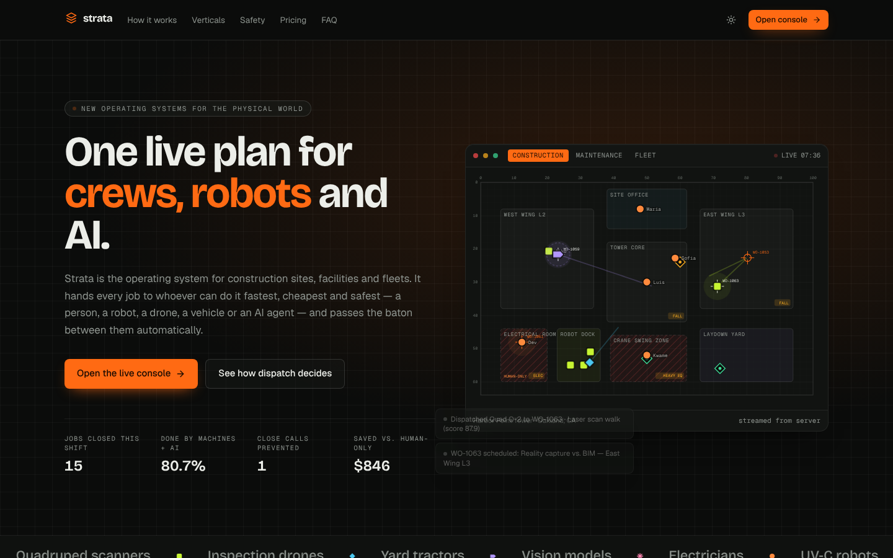
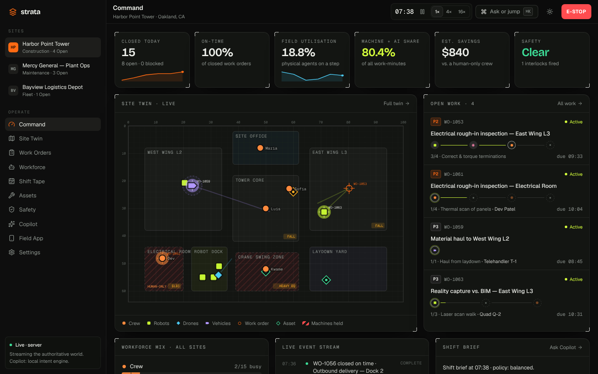
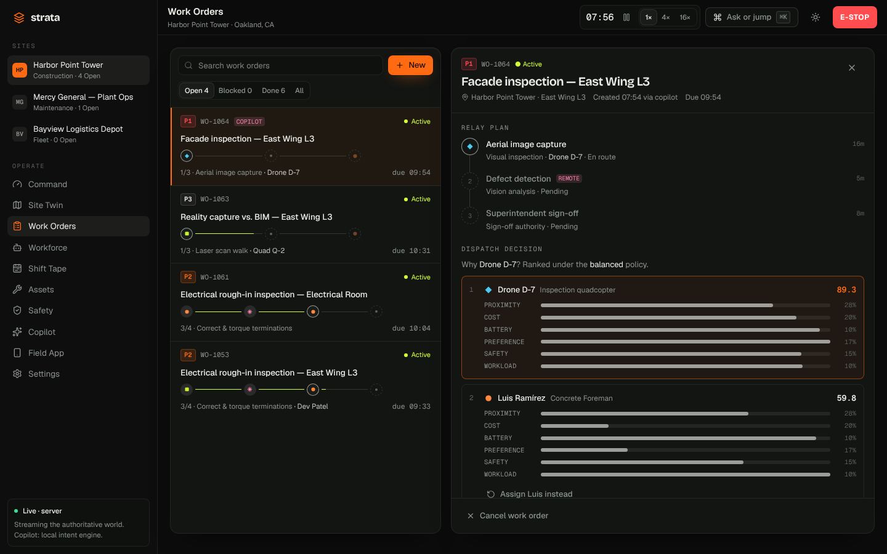
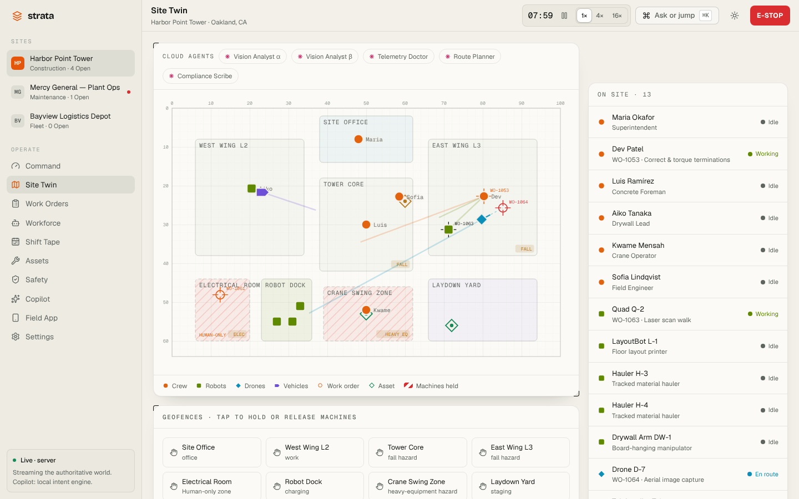
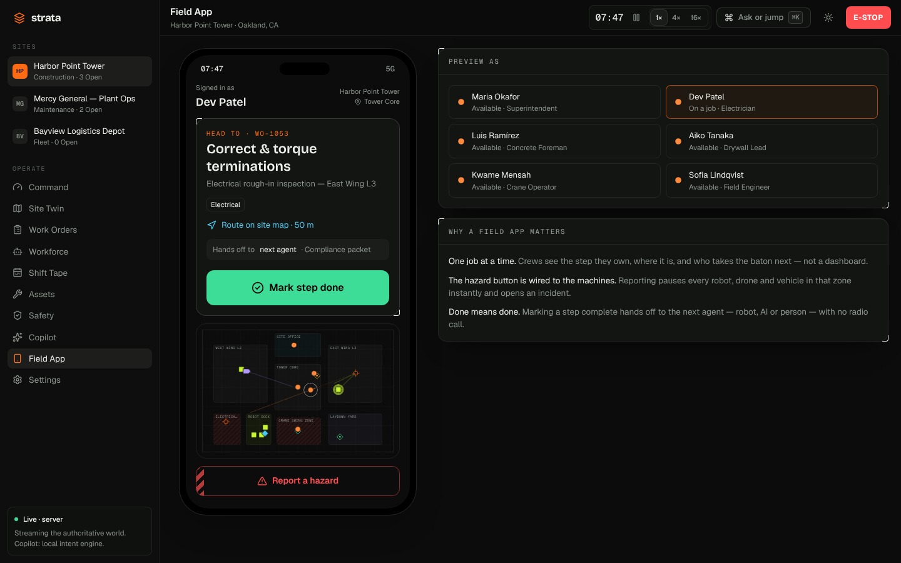
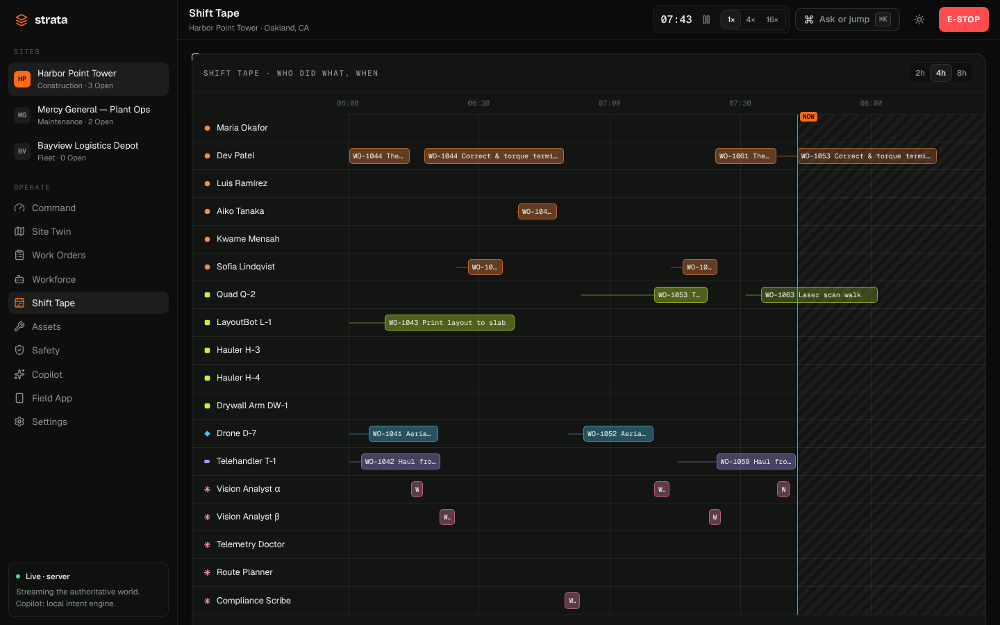
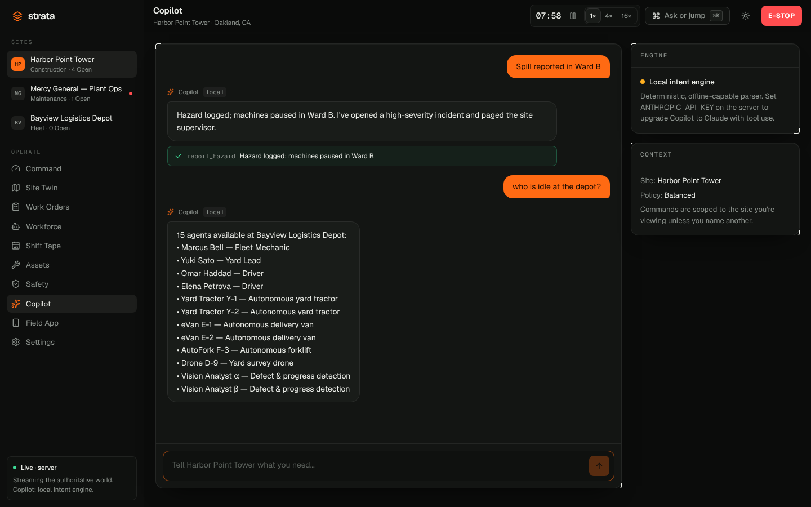

<div align="center">

# ◈ Strata

### The operating system for the physical world

**One live plan for crews, robots, drones, vehicles and AI agents across construction, maintenance and fleets.**

Inspired by the Y Combinator Request for Startups theme *"New operating systems for the physical world: software that coordinates workers, robots and AI in construction, maintenance and fleets."*

`React 19` · `TypeScript` · `Tailwind v4` · `Vite` · `Hono` · `Server-Sent Events` · `Claude (optional)` · `Vitest`

</div>



---

## Why

Every construction site, hospital campus and logistics yard is turning into a **mixed fleet**: people working alongside quadrupeds, drones, autonomous haulers, yard tractors, UV-C robots and AI models that can read imagery and telemetry. But:

- **Robots arrive as islands.** Each one has its own app, and nothing plans across them.
- **AI has no hands.** A model can spot a crack or predict a failing bearing, but nothing turns that into a dispatched, verified job.
- **Safety is bolted on.** Interlocks, geofences and certification checks live in binders, not in the plan.

**Strata is the coordination layer.** It treats every worker — human, robot, drone, vehicle or AI — as one roster with one capability model, turns every job into a **relay** of steps, and hands each step to whoever can do it fastest, cheapest and safest. Every decision comes with its reasoning.

> The full product brief and the prompt this project was built from are in **[docs/PROMPT.md](docs/PROMPT.md)**.

## What's inside

| Surface | What it does |
| --- | --- |
| **Landing** | Explains the idea with the *real product running live* in the hero, plus how it works, verticals, safety, why now, pricing and FAQ. |
| **Command Center** | KPIs (closed, on-time, utilisation, machine + AI share, savings vs. a human-only crew, safety), live twin, open work, workforce mix, event stream, shift brief and a live thumbnail of every site. |
| **Site Twin** | Blueprint-style live map: zones, hazards, geofences, assets, work-order pins, and agents with trails, headings and safety buffers. Cloud AI agents sit beside the map. Tap a zone to hold or release machines. |
| **Work Orders** | Relay plans with step outputs, plus the **dispatch decision**: ranked candidates, weighted factor bars, blockers and one-click overrides. Create jobs from 17 templates. |
| **Workforce** | One roster across five kinds of worker, with status, energy, capabilities and certifications. |
| **Shift Tape** | Swimlane timeline of who did what and when, including travel and projected finish. |
| **Assets** | Predictive maintenance. Health rings, trends and telemetry. Sensors raise work orders on their own. |
| **Safety** | Proximity interlocks, hazard reports, geofence holds and an incident log with resolve actions. |
| **Copilot** | Run the site in plain language. Uses Claude tool use when a key is set, otherwise a deterministic local intent engine. Every action comes back with a receipt. |
| **Field App** | The crew's phone view: one job at a time, the next hand-off, a big *Mark step done* button, and a hazard button wired to the machines. |
| **⌘K** | One bar to jump anywhere or tell Copilot what to do. `g` + key shortcuts for every page. |

<table>
<tr>
<td></td>
<td></td>
</tr>
<tr>
<td align="center"><sub>Command Center</sub></td>
<td align="center"><sub>Explainable dispatch: why this agent, and who almost qualified</sub></td>
</tr>
<tr>
<td></td>
<td></td>
</tr>
<tr>
<td align="center"><sub>Site Twin, day-shift theme</sub></td>
<td align="center"><sub>Field App</sub></td>
</tr>
<tr>
<td></td>
<td></td>
</tr>
<tr>
<td align="center"><sub>Shift Tape</sub></td>
<td align="center"><sub>Copilot with action receipts</sub></td>
</tr>
</table>

## How dispatch decides

1. **Hard constraints, never traded off.** Capability, site, physical presence, busy/offline/held, **human-only** and **patient-care** geofences, paused zones, **NFPA-70E** for electrical hazards, **fall protection** at height, and **battery sufficiency** (travel + work + reserve) for machines.
2. **Policy-weighted score** across proximity/ETA, cost, energy, kind preference, safety exposure and fair workload. You can switch between `balanced`, `fastest`, `cheapest` and `safest` live.
3. **Explain and hand off.** The top candidates are stored with every assignment. When a step finishes, its output is recorded and the next step is dispatched on the next tick.

**Safety loop:** a heavy machine that comes within 3.5 m of a person is held, logged, then allowed to creep past at reduced speed. Hazard reports and geofence holds pause the machines in a zone, and **E-STOP** pauses every machine on the site.

## Edge-first

The engine in [`core/`](core) is pure, deterministic TypeScript, and the **same code runs on the server and in the browser**:

- **Live mode**: the UI streams snapshots from the API over Server-Sent Events and posts commands.
- **Edge mode**: if the server can't be reached (or you open `?mode=edge`), the browser boots the engine itself. That's how a site tablet keeps working when the network drops, and it lets the frontend deploy as a static site.

See **[docs/ARCHITECTURE.md](docs/ARCHITECTURE.md)** for the full design.

## Quick start

```bash
git clone https://github.com/samar403/New-operating-systems-for-the-physical-world.git
cd new-operating-systems-for-the-physical-world
npm install
npm run dev          # API on :8787 + web on :5173
```

Open <http://localhost:5173>. Press **⌘K / Ctrl+K** and try:

- `Send a drone to inspect the east wing facade asap`
- `Pause robots in the crane zone`
- `Spill reported in Ward B`
- `Fix the brakes on tractor 112`
- `Optimise for safety`
- `Give me the shift brief`

### Claude-powered Copilot (optional)

```bash
cp .env.example .env    # then set ANTHROPIC_API_KEY
ANTHROPIC_API_KEY=sk-ant-... npm run dev:server
```

With a key set, `/api/copilot` uses Claude with typed tools that mirror the engine's commands. Every call still goes through the engine's validation. Without a key, or if a call fails, the local intent engine answers.

## Scripts

| Command | Purpose |
| --- | --- |
| `npm run dev` | API server (watch) + Vite dev server |
| `npm run build` | Typecheck + production web build to `dist/` |
| `npm start` | Production server: API + built web app on `:8787` |
| `npm test` | Engine, dispatcher, safety and Copilot tests (Vitest) |
| `npm run typecheck` | `tsc --noEmit` across core, server and web |

## Deploy

- **Docker (full stack):** `docker build -t strata . && docker run -p 8787:8787 -e ANTHROPIC_API_KEY=... strata`
- **Static (Edge mode):** `vercel.json` and `web/public/_redirects` are included. The frontend runs the engine in the browser, so no server is needed.

## Project layout

```
core/      Pure domain engine: types, seed world, templates, dispatcher, tick loop, insights, local Copilot (+ tests)
server/    Hono API: SSE stream, commands, Claude Copilot, static hosting in production
web/       React app: landing page, app shell, ⌘K, Site Twin, pages, design tokens
docs/      Product brief/prompt, architecture, screenshots
```

## Design system

The project starts from a universal SaaS starter structure (marketing site + app shell + token-based theming) and re-tunes it into a field-instrument look:

- **Night shift / day shift** themes driven by CSS variables (graphite and warm paper).
- **Hi-vis safety orange** is the only action colour. A **chartreuse signal** marks live machine state.
- **One colour and one glyph per kind of worker**, used everywhere: ● human · ■ robot · ◆ drone · ▶ vehicle · ✳ AI.
- Survey-grid backdrops, **viewfinder card corners**, hazard-tape accents, monospace telemetry with tabular numbers.
- Responsive down to 390 px, keyboard navigable, `prefers-reduced-motion` aware.

## License

MIT © samar403
